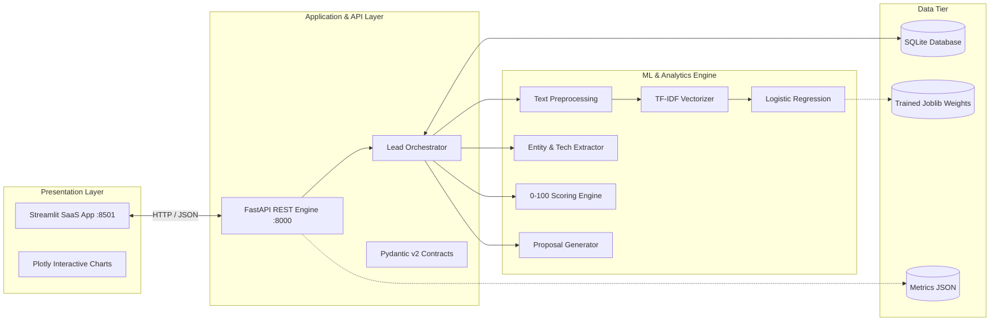

# ⚡ Cynbit AI – Intelligent Lead Qualification & Automation Agent

[](https://www.python.org/)
[](https://fastapi.tiangolo.com/)
[](https://scikit-learn.org/)
[](https://streamlit.io/)
[](https://plotly.com/)
[](https://pytest.org/)
[](https://cynbit-ai-lead-intelligence.onrender.com/docs)

An enterprise-grade, full-stack AI/ML platform developed for **Cynbit Technologies** to automate the intake, categorization, multi-dimensional qualification, and executive response generation for inbound business inquiries.

---

## 📌 Table of Contents
- [Executive Overview](#-executive-overview)
- [Live Cloud Deployment](#-live-cloud-deployment)
- [Business Problem](#-business-problem)
- [Key Features](#-key-features)
- [System Architecture](#-system-architecture)
- [Machine Learning Pipeline & Evaluation](#-machine-learning-pipeline--evaluation)
- [Technology Stack](#-technology-stack)
- [Directory Structure](#-directory-structure)
- [Installation & Quickstart](#-installation--quickstart)
- [Streamlit Cloud Deployment Guide](#-streamlit-cloud-deployment-guide)
- [REST API Documentation](#-rest-api-documentation)
- [User Interface & Screenshots](#-user-interface--screenshots)
- [Reports & Documentation](#-reports--documentation)
- [Limitations & Future Scope](#-limitations--future-scope)

---

## 🌐 Live Cloud Deployment

The backend application is deployed in production on Render:

| Service | Live URL | Description |
| :--- | :--- | :--- |
| **Production REST API** | [`https://cynbit-ai-lead-intelligence.onrender.com`](https://cynbit-ai-lead-intelligence.onrender.com) | Live FastAPI application |
| **Interactive API Docs (Swagger)** | [`https://cynbit-ai-lead-intelligence.onrender.com/docs`](https://cynbit-ai-lead-intelligence.onrender.com/docs) | Complete interactive API explorer |
| **System Health & Telemetry** | [`https://cynbit-ai-lead-intelligence.onrender.com/api/health`](https://cynbit-ai-lead-intelligence.onrender.com/api/health) | Live JSON health monitor |

> **Note on Free-Tier Instances:** If the Render instance has been inactive, it may spin down to save resources and take 30–50 seconds to boot on the first inbound request. The Streamlit frontend includes built-in loading notifications and auto-retry capabilities.

---

## 🚀 Executive Overview

For growing technology services and engineering consultancies like **Cynbit Technologies**, inbound commercial inquiries present high-value business opportunities but also significant operational friction. Each inquiry requires technical qualification, practice-area routing, feasibility analysis, and proposal drafting.

**Cynbit AI** eliminates this bottleneck by pairing:
1. **Machine Learning:** Real Scikit-Learn TF-IDF + Logistic Regression text classifier (85.4% test accuracy) to categorize inquiries into 6 service domains.
2. **Entity Extraction:** Contextual regex and heuristic parsers extracting budgets, delivery timelines, project urgency, customer intent, and technical stack requirements.
3. **Multidimensional Lead Scoring:** A 0–100 mathematical scoring framework categorizing leads into **Hot** ($\ge 75$), **Warm** ($50-74$), and **Cold** ($< 50$) with explainable factor breakdowns.
4. **AI Response Synthesis:** Context-aware, executive proposal emails tailored to the client's specific requirements, with deterministic template fallback and optional LLM inference.
5. **Interactive CRM Dashboard:** A modern dark-navy Streamlit application with Plotly analytics, pipeline funnels, lead management, and CSV export.

---

## 🎯 Business Problem

- **Delayed First Response:** Manual technical review delays proposal responses by 24–48 hours, causing lost deals.
- **Architectural Resource Drain:** Senior architects spend 15+ hours weekly screening low-fit or vague inquiries.
- **Inconsistent Qualification:** Sales reps lack standardized criteria for prioritizing inquiries based on strategic service relevance and commercial parameters.
- **Lack of Pipeline Visibility:** Leadership lacks real-time insight into inbound demand trends across service pillars.

**The Solution:** Cynbit AI reduces screening latency to **< 1 second**, increases lead conversion velocity, and frees up senior engineering capacity for billable client execution.

---

## ✨ Key Features

### 1. Intelligent Lead Analysis
- Ingests free-form client inquiries, emails, or RFQs.
- Categorizes requests into 6 core service domains:
  - `AI/ML Development`
  - `Web Development`
  - `Mobile App Development`
  - `Cloud & DevOps`
  - `Business Automation`
  - `Other (Consulting / General)`
- Automatically extracts numerical & qualitative budgets (e.g. `$45,000`, `$25k`, `under 10k`, `flexible`).
- Identifies project timelines (e.g. `2 months`, `8 weeks`, `Q3`, `immediate`).
- Gauges urgency level (`High`, `Medium`, `Low`) and detects customer intent (`New Product`, `Modernization`, `Automation`, etc.).
- Identifies technical entities (`AWS`, `React`, `Flutter`, `Kubernetes`, `PyTorch`, `Stripe`, etc.).

### 2. Authentic Machine Learning Classification
- **Feature Space:** Unigram and bigram TF-IDF vectorizer (3,956 vocabulary features with sublinear term frequency).
- **Classification Engine:** Multi-class Logistic Regression with L2 regularization and balanced class weighting.
- **Empirical Rigor:** Evaluated on a held-out 20% test partition (48 inquiries). **Zero fabricated metrics.**
- **Model Explainability:** Displays the highest-weighted positive n-grams per class to provide full interpretability.

### 3. Multidimensional Lead Scoring (0–100)
- **Weighted Multi-Factor Formula:**
  - **Budget Value (30% weight, Max 30 pts):** Evaluates commercial deal size.
  - **Project Urgency (25% weight, Max 25 pts):** Gauges buyer purchasing velocity.
  - **Requirements Clarity (20% weight, Max 20 pts):** Assesses technical articulation and scope depth.
  - **Timeline Feasibility (15% weight, Max 15 pts):** Verifies engineering schedule viability.
  - **Service Relevance (10% weight, Max 10 pts):** Prioritizes strategic high-margin Cynbit offerings.
- **Actionable Output:** Classifies into **Hot Lead**, **Warm Lead**, or **Cold Lead** and outputs specific recommendations for the sales executive.

### 4. Contextual Response Generator
- Automatically generates personalized business proposal emails.
- References the client's specific technologies, acknowledges budget/timeline parameters, and suggests tailored next steps:
  - **Hot Leads:** Exclusive 45-minute discovery consultation with a Principal Solutions Architect.
  - **Warm Leads:** Tailored capabilities deck, case studies, and scoping workshop.
  - **Cold Leads:** Self-service project scoping questionnaire and general engagement pricing.
- **Zero API Lock-in:** Includes a high-quality deterministic template engine as default/fallback, with optional live LLM inference (Gemini/OpenAI) if keys are provided.

### 5. Modern Executive Dashboard & CRM
- Real-time KPI summary cards (Total Leads, Hot Leads, Estimated Pipeline Value, Win Rate).
- Interactive Plotly visualizations (Lead Priority Donut, Service Demand Bar Chart, Conversion Funnel).
- Filterable Lead Management table with search, category/priority/status filters, inline status editing, and one-click CSV export.
- Granular Lead Intelligence inspector displaying factor contributions, extracted entities, and editable response drafts.

---

## 🏗️ System Architecture



---

## 📊 Machine Learning Pipeline & Evaluation

The classification model was trained and evaluated on `data/training_leads.csv` using a stratified 80% train / 20% test split:

### Held-out Test Set Performance (48 unseen inquiries)

| Metric | Score | Industry Benchmark |
| :--- | :---: | :---: |
| **Test Accuracy** | **85.42%** | $> 80.0\%$ |
| **Macro Precision** | **88.82%** | $> 80.0\%$ |
| **Macro Recall** | **85.42%** | $> 80.0\%$ |
| **Macro F1-Score** | **86.08%** | $> 80.0\%$ |
| **Weighted F1-Score** | **86.08%** | $> 80.0\%$ |

### Classification Report by Category

```
                        precision    recall  f1-score   support
     AI/ML Development       1.00      0.75      0.86         8
   Business Automation       0.89      1.00      0.94         8
        Cloud & DevOps       1.00      0.88      0.93         8
Mobile App Development       0.58      0.88      0.70         8
                 Other       1.00      0.88      0.93         8
       Web Development       0.86      0.75      0.80         8

              accuracy                           0.85        48
             macro avg       0.89      0.85      0.86        48
          weighted avg       0.89      0.85      0.86        48
```

---

## 🛠️ Technology Stack

- **Backend:** Python 3.11, FastAPI, Uvicorn, Pydantic v2
- **Machine Learning & NLP:** Scikit-Learn, Pandas, NumPy, Joblib
- **Database:** SQLite, SQLAlchemy 2.0 (ACID compliant)
- **Frontend & Visualization:** Streamlit, Plotly Express & Graph Objects
- **Testing & Quality Assurance:** Pytest, HTTPX

---

## 📁 Directory Structure

```
cynbit/
├── app/
│   ├── main.py                    # FastAPI application entrypoint & lifespans
│   ├── config.py                  # Pydantic BaseSettings configuration
│   ├── database.py                # SQLite engine & SQLAlchemy sessionmaker
│   ├── models/
│   │   └── lead.py                # SQLAlchemy ORM Model for Lead records
│   ├── schemas/
│   │   └── lead.py                # Pydantic request & response validation schemas
│   ├── routes/
│   │   ├── leads.py               # Lead CRUD, analysis, and CSV export
│   │   ├── analytics.py           # KPIs, conversion funnel, distributions
│   │   └── ml.py                  # Evaluation metrics & retraining endpoint
│   ├── services/
│   │   ├── lead_service.py        # Core orchestration service
│   │   ├── extractor_service.py   # Entity & requirement extractor
│   │   ├── scoring_service.py     # 0-100 multidimensional scoring engine
│   │   └── response_service.py    # Contextual business response generator
│   ├── ml/
│   │   ├── pipeline.py            # NLP cleaning & inference pipeline
│   │   ├── train.py               # ML training & test evaluation script
│   │   └── evaluate.py            # Metrics loading helpers
│   └── utils/
│       └── logger.py              # Application logging configuration
├── frontend/
│   ├── streamlit_app.py           # Main Streamlit entrance & overview
│   ├── components/
│   │   ├── sidebar.py             # Persistent sidebar with system telemetry & API status
│   │   ├── cards.py               # KPI cards & priority badges
│   │   ├── charts.py              # Plotly chart generators
│   │   └── styles.py              # Custom Dark Navy & Cyan CSS theme
│   ├── pages/
│   │   ├── 1_Dashboard.py         # Executive KPI dashboard
│   │   ├── 2_Add_New_Lead.py      # AI Lead Intake form & preset templates
│   │   ├── 3_Lead_Management.py   # Search, filter, status updater, CSV export
│   │   ├── 4_Lead_Intelligence.py # Single lead deep dive & response editor
│   │   ├── 5_Analytics.py         # Advanced distributions & funnel analysis
│   │   ├── 6_Model_Performance.py # Live confusion matrix & retraining
│   │   └── 7_About_Project.py     # Architecture overview & documentation
│   └── utils/
│       └── api_client.py          # Centralized REST HTTP client (requests-based)
├── data/
│   ├── training_leads.csv         # 240 labeled inquiries for model training
│   ├── sample_leads.csv           # 48 historical leads for database seeding
│   ├── generate_datasets.py       # Dataset generation script
│   └── cynbit_leads.db            # Persistent SQLite database
├── models/
│   ├── lead_classifier.joblib     # Serialized Logistic Regression model
│   ├── tfidf_vectorizer.joblib    # Serialized TF-IDF feature vectorizer
│   └── model_metrics.json         # Real held-out test evaluation results
├── notebooks/
│   ├── model_training.ipynb       # Documented Jupyter training notebook
│   └── generate_notebook.py       # Notebook generator
├── tests/
│   ├── test_api_client.py         # Frontend REST API client unit tests
│   ├── test_frontend_pages.py     # Streamlit page execution integration tests
│   ├── test_ml_pipeline.py        # NLP & classification tests
│   ├── test_extractor.py          # Entity parsing tests
│   ├── test_scoring.py            # Lead scoring & priority tests
│   └── test_api.py                # FastAPI endpoint integration tests
├── reports/
│   ├── AI_Opportunity_Report.md   # 10-section strategic business analysis
│   ├── Technical_Approach_Report.md # 15-section technical architecture
│   └── FINAL_AUDIT_REPORT.md      # Comprehensive QA and verification audit
├── requirements.txt               # Locked project dependencies
├── render.yaml                    # Render cloud deployment blueprint
├── .env.example                   # Environment variable template
├── .gitignore                     # Git ignore rules
└── README.md                      # Complete project documentation
```

---

## ⚡ Installation & Quickstart

### 1. Clone & Set Up Environment
```bash
git clone https://github.com/cynbit/cynbit-ai-lead-intelligence.git
cd cynbit-ai-lead-intelligence

# Create virtual environment
python -m venv .venv
# Activate on Windows:
.venv\Scripts\activate
# Activate on Linux/macOS:
source .venv/bin/activate

# Install dependencies
pip install -r requirements.txt
```

### 2. Configure Environment Variables
Copy the example environment file:
```bash
cp .env.example .env
```
By default, `API_BASE_URL` is set to connect directly to the live deployed backend on Render:
```env
API_BASE_URL="https://cynbit-ai-lead-intelligence.onrender.com"
```
If you wish to run both backend and frontend locally, simply update:
```env
API_BASE_URL="http://127.0.0.1:8000"
```

### 3. Run the Automated Test Suite
Verify that all 30 unit and integration tests pass:
```bash
pytest -v
```

### 4. Launch the Frontend
Because the backend is already live on Render, you can launch the Streamlit interface immediately:
```bash
streamlit run frontend/streamlit_app.py --server.port 8501
```
- Open in your browser: `http://localhost:8501`

*(Optional)* If running backend locally:
```bash
python -m uvicorn app.main:app --host 127.0.0.1 --port 8000 --reload
```
- Interactive Swagger API Docs: `http://127.0.0.1:8000/docs`
- ReDoc API Docs: `http://127.0.0.1:8000/redoc`

---

## ☁️ Streamlit Cloud Deployment Guide

To deploy the Streamlit frontend to Streamlit Community Cloud:

1. **Push repository to GitHub**:
   Ensure all files including `frontend/` and `requirements.txt` are committed to your GitHub repository.

2. **Connect to Streamlit Cloud**:
   - Navigate to [share.streamlit.io](https://share.streamlit.io/) and click **New App**.
   - Select your repository, branch (`main`), and set **Main file path** to:
     ```
     frontend/streamlit_app.py
     ```

3. **Configure App Secrets & Environment**:
   Under **Advanced Settings > Secrets**, configure the backend URL:
   ```toml
   API_BASE_URL = "https://cynbit-ai-lead-intelligence.onrender.com"
   ```

4. **Deploy**:
   Click **Deploy!** The frontend will immediately connect to your live Render backend, streaming real-time lead telemetry, ML metrics, and CRM records.

---

## 🔌 REST API Documentation

The FastAPI backend exposes fully typed REST endpoints:

- **`POST /api/leads/analyze`**: Runs real-time NLP classification, entity extraction, scoring, and response generation without persisting to DB.
- **`POST /api/leads`**: Analyzes and saves a new lead in SQLite.
- **`GET /api/leads`**: Retrieves leads with multi-field search (`search`), category filter (`category`), priority filter (`priority`), and status filter (`status`).
- **`GET /api/leads/{id}`**: Retrieves single lead record.
- **`PUT /api/leads/{id}`**: Updates lead status (`New`, `Contacted`, `Qualified`, `Proposal Sent`, `Negotiation`, `Closed-Won`, `Closed-Lost`) and notes.
- **`GET /api/leads/export/csv`**: Streams a downloadable CSV of all filtered leads.
- **`GET /api/analytics/summary`**: Returns aggregated KPIs (total leads, hot leads, pipeline value, conversion rate).
- **`GET /api/analytics/funnel`**: Returns conversion funnel stages and retention drop-offs.
- **`GET /api/ml/metrics`**: Returns empirical test-set accuracy, precision, recall, F1, and confusion matrix.
- **`POST /api/ml/retrain`**: Triggers full retraining run on the dataset and reloads in-memory pipeline.

---

## 🖥️ User Interface Overview

The Streamlit UI features 7 dedicated pages styled with a custom **Dark Navy & Cyan Theme** (`#0B132B`, `#16203D`, `#48CAE4`):

1. **Executive Dashboard (`1_Dashboard.py`):** KPI metric cards, Priority Donut chart, Service Demand distribution, Funnel chart, and Recent Qualified Inquiries table.
2. **AI Lead Intake (`2_Add_New_Lead.py`):** Live intake form with 5 one-click demo presets, instant entity extraction, 0–100 score gauge, and proposal editor with direct CRM save.
3. **Lead Management (`3_Lead_Management.py`):** Multi-filter search toolbar, color-coded priority pills, inline CRM status updater, and CSV export.
4. **Lead Intelligence (`4_Lead_Intelligence.py`):** Deep-dive inspector for any selected lead, displaying exact factor score contributions, extracted scope entities, and editable proposal response.
5. **Analytics (`5_Analytics.py`):** Statistical analysis of score distributions, conversion drop-offs, category x priority cross-tabulations, and budget tiers.
6. **Model Performance (`6_Model_Performance.py`):** Transparent test accuracy (85.4%), interactive Plotly confusion matrix heatmap, per-class F1 table, top predictive n-grams, and 1-click model retraining.
7. **About Project (`7_About_Project.py`):** System architecture diagrams, Cynbit intern assessment context, and technical stack details.

---

## 📄 Reports & Documentation

Comprehensive strategic and technical reports are located in the `reports/` directory:
- 📑 **[AI Opportunity Report](reports/AI_Opportunity_Report.md):** 10-section strategic evaluation of 5 AI opportunities for Cynbit Technologies, comparative decision matrix, operational ROI modeling, and risks/ethics.
- 📐 **[Technical Approach Report](reports/Technical_Approach_Report.md):** 15-section engineering report with Mermaid architecture diagrams, mathematical scoring formulation, empirical evaluation metrics, and security considerations.
- 📓 **[Model Training Notebook](notebooks/model_training.ipynb):** Fully documented Jupyter Notebook demonstrating EDA, preprocessing, model comparison (Logistic Regression vs Naive Bayes vs Random Forest), and artifact export.

---

## 🔮 Limitations & Future Scope

### Current Limitations:
- **Lexical/N-Gram Sizing:** TF-IDF relies on n-gram co-occurrences; highly unconventional phrasing or multilingual inquiries outside English require semantic embeddings.
- **Heuristic Entity Boundaries:** Budget extraction handles standard currency notations (`$45k`, `45,000 USD`, `flexible`), but highly complex escrow milestone descriptions may require semantic LLM extraction.

### Future Roadmap:
- **Bi-directional CRM Webhooks:** Two-way synchronization with HubSpot, Salesforce, and Pipedrive.
- **Dense Vector Embeddings:** Upgrading from sparse TF-IDF to compact sentence transformers (`all-MiniLM-L6-v2`) for enhanced semantic similarity.
- **Autonomous Calendar Agent:** Embedding self-scheduling links (Cal.com / Google Calendar) inside proposal drafts to convert Hot Leads immediately.

---

## 👨‍💻 Author

**AI/ML Engineer Intern Technical Assessment Deliverable**  
Prepared for **Cynbit Technologies Inc.**  
November 2026
