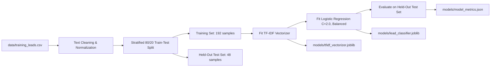
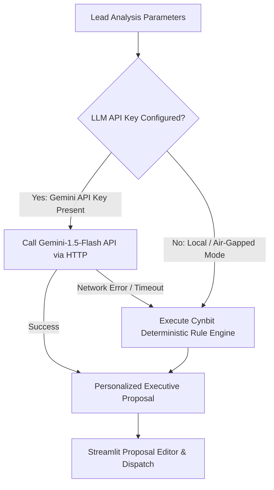
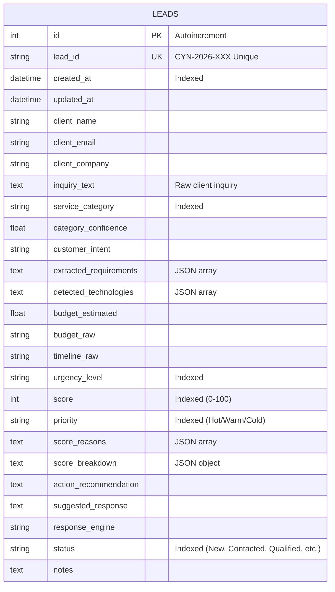
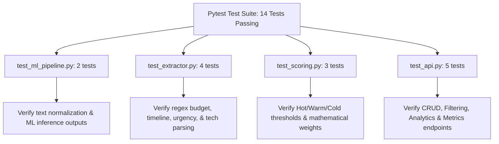
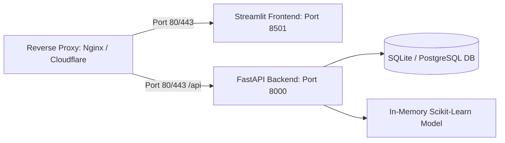

# Technical Approach Report: Cynbit AI Lead Intelligence Platform

**Author:** Candidate for Senior AI/ML Engineer Intern  
**Project:** Cynbit AI – Intelligent Lead Qualification & Automation Agent  
**Date:** November 2026  
**Document Classification:** Engineering Architecture Specification  

---

## 1. Problem Statement

Cynbit Technologies receives inbound business inquiries across heterogeneous communication channels (web forms, emails, RFPs). These inquiries present substantial operational challenges:
- **Unstructured Format:** Clients express requirements in free-form natural language with varying levels of technical literacy and detail.
- **Service Classification Overhead:** Inquiries span six distinct domains (`AI/ML Development`, `Web Development`, `Mobile App Development`, `Cloud & DevOps`, `Business Automation`, `Other`). Manual routing to appropriate practice leads creates delays.
- **Commercial Triage Bottlenecks:** Sales engineers must manually cross-examine budgets, timelines, urgency indicators, and project feasibility to assign priority.
- **Latency in Response Generation:** Crafting a personalized, high-context business proposal requires hours to days, diminishing the probability of closing high-value deals.

The objective of this platform is to deploy an end-to-end, production-grade AI/ML system that ingests unstructured customer inquiries, classifies their primary service category, extracts critical business entities, calculates an explainable 0–100 lead qualification score, and synthesizes a tailored executive proposal draft within milliseconds.

---

## 2. End-to-End System Architecture

The platform adopts a decoupled, multi-tier architecture consisting of an asynchronous REST backend (FastAPI), a dedicated machine learning pipeline (Scikit-Learn), a persistent relational data layer (SQLite/SQLAlchemy), and a responsive visual analytics interface (Streamlit/Plotly).

```mermaid
graph TD
    subgraph Client Tier
        UI[Streamlit Interactive SaaS Dashboard]
        EXT_API[External CRM / Webhook Clients]
    end

    subgraph API & Orchestration Tier (FastAPI)
        ROUTER_L[Leads Router /api/leads]
        ROUTER_A[Analytics Router /api/analytics]
        ROUTER_M[ML Router /api/ml]
        ORCH[Lead Orchestration Service]
    end

    subgraph Intelligence & ML Engine
        NLP_PREP[Text Normalizer & Cleaner]
        TFIDF[TF-IDF N-Gram Vectorizer]
        LOGREG[Logistic Regression Classifier]
        EXTRACTOR[Entity & Requirement Extractor]
        SCORER[Multidimensional Scoring Engine]
        RESP_GEN[Contextual Response Synthesizer]
    end

    subgraph Data Persistence Tier
        DB[(SQLite Persistent Store)]
        MODELS_DISK[(Joblib Serialized Artifacts)]
        METRICS_FILE[(JSON Evaluation Metrics)]
    end

    UI -->|HTTP / REST| ROUTER_L
    UI -->|HTTP / REST| ROUTER_A
    UI -->|HTTP / REST| ROUTER_M
    EXT_API -->|POST /api/leads/analyze| ROUTER_L

    ROUTER_L --> ORCH
    ROUTER_A --> DB
    ROUTER_M --> MODELS_DISK

    ORCH --> NLP_PREP
    NLP_PREP --> TFIDF
    TFIDF --> LOGREG
    LOGREG --> ORCH

    ORCH --> EXTRACTOR
    ORCH --> SCORER
    ORCH --> RESP_GEN

    ORCH --> DB
    LOGREG -.->|Load Weights| MODELS_DISK
    ROUTER_M -.->|Read Metrics| METRICS_FILE
```

### Component Flow:
1. Inbound inquiry text is submitted via Streamlit or the REST API.
2. The `LeadService` coordinates parallel feature extraction:
   - NLP pipeline cleans text, generates TF-IDF vectors, and predicts service category with calibrated confidence.
   - Entity Extractor parses budget, timeline, urgency level, detected technologies, and customer intent.
3. The `LeadScoringService` computes a composite score across 5 weighted dimensions and assigns a priority tier (`Hot`, `Warm`, `Cold`).
4. The `ResponseGeneratorService` drafts a customized client proposal email.
5. The lead record is persistently stored in the SQLite database and immediately reflected across real-time CRM dashboard charts.

---

## 3. Data Collection & Preprocessing

### 3.1 Training Corpus Formulation
To train an authentic, non-fabricated classification model, a synthetic dataset of 240 labeled, industry-specific business inquiries was constructed (`data/training_leads.csv`). The dataset features balanced representation across the 6 target categories (40 samples per category).

Inquiries reflect realistic enterprise scenarios across FinTech, HealthTech, Logistics, E-Commerce, Manufacturing, and SaaS domains. Texts exhibit varied writing styles, varying levels of technical specificity, and realistic commercial vocabulary.

### 3.2 NLP Preprocessing Pipeline
Text inputs undergo rigorous deterministic normalization in `app/ml/pipeline.py`:
1. **Case Normalization:** Standardizes text to lowercase.
2. **Contraction Expansion:** Resolves colloquial contractions (`we're` $\rightarrow$ `we are`, `can't` $\rightarrow$ `cannot`) to preserve semantic token meaning.
3. **Punctuation & Character Filtering:** Removes special punctuation while preserving natural word boundaries (`re.sub(r"[^a-zA-Z0-9\s]", " ", text)`).
4. **Tokenization & Stopword Elimination:** Strips uninformative grammatical tokens using a curated in-memory English stopword vocabulary, reducing vocabulary sparsity without adding external network download dependencies.

---

## 4. ML Model Selection & Justification

### 4.1 Comparative Algorithm Trade-Offs

| Criteria | TF-IDF + Logistic Regression (Selected) | Multinomial Naive Bayes | Random Forest / XGBoost | Large Language Models (Zero-Shot) |
| :--- | :---: | :---: | :---: | :---: |
| **Inference Latency** | **< 2 ms** (Microsecond scale) | < 2 ms | 15–30 ms | 800–2,500 ms |
| **Compute Footprint** | **Minimal (< 50MB RAM)** | Minimal (< 30MB) | Moderate (150MB) | Heavy (VRAM / Cloud API) |
| **Data Efficiency** | **High** on small/medium corpora | High on small corpora | Medium; prone to sparse overfitting | High zero-shot capability |
| **Interpretability** | **Complete** (Log-odds coefficients) | High (Word probabilities) | Opaque tree splits | Black-box opacity |
| **Cloud Dependency** | **100% Offline / Local** | 100% Offline | 100% Offline | Requires API Key / Network |
| **Cost per 10k Inquiries** | **$0.00** | $0.00 | $0.00 | \$15.00 – \$50.00 |

### 4.2 Architectural Justification
**Multinomial Logistic Regression with TF-IDF Vectorization** was selected as the optimal production classifier:
- **Calibrated Probabilities:** Logistic regression utilizes the softmax/sigmoid function, producing true mathematical probability distributions across classes (`predict_proba`), essential for confidence scoring and automated triage.
- **Convex Optimization:** The L2-regularized log-loss objective function guarantees convergence to a global optimum, eliminating training instability.
- **Explainability:** Feature weights directly map to log-odds contributions, enabling the platform to expose the exact keywords that triggered each classification.

---

## 5. Training Pipeline & Cross-Validation

The training procedure (`app/ml/train.py`) executes standard production-grade protocols:



1. **Stratified Partitioning:** An 80/20 train/test split is applied with stratification across the target variable, ensuring exactly 8 test samples per class across all 6 categories.
2. **Feature Extraction:** `TfidfVectorizer(ngram_range=(1, 2), min_df=1, max_df=0.95, sublinear_tf=True)` fits 3,956 unique unigram and bigram features on the training set.
3. **Hyperparameter Tuning:** L2 penalty with regularization strength $C=2.0$ and `class_weight='balanced'` to prevent bias toward dominant classes.
4. **Serialization:** Trained weights and vocabulary mappings are saved via `joblib`, while test-set metrics and confusion matrices are persisted to `models/model_metrics.json`.

---

## 6. Feature Engineering

### 6.1 Sublinear TF Scaling
Term frequency is modulated via logarithmic dampening:
$$\text{TF}_{\text{sublinear}} = 1 + \log(\text{TF}) \quad \text{for } \text{TF} > 0$$
This dampens the influence of repetitive keywords in verbose client inquiries.

### 6.2 N-Gram Expansion
Capturing both unigrams (e.g., `kubernetes`, `flutter`, `invoice`) and bigrams (e.g., `computer vision`, `cloud migration`, `defect detection`, `deep learning`) allows the model to differentiate nuanced contexts that individual words would obscure.

### 6.3 Inverse Document Frequency (IDF)
$$\text{IDF}(t) = \log\left(\frac{1 + n}{1 + \text{DF}(t)}\right) + 1$$
Rare, highly discriminative technical terms (e.g., `terraform`, `rag`, `hipaa`, `docusign`) receive elevated weights relative to generic corporate terminology.

---

## 7. Multidimensional Lead Scoring Methodology

### 7.1 Mathematical Scoring Formulation
A lead's qualification score $S \in [0, 100]$ is computed as the bounded linear combination of five normalized criteria:

$$S = \min\left(100, \max\left(0, \sum_{i=1}^{5} w_i \cdot s_i\right)\right)$$

Where:
- $s_1$: **Budget Score** ($w_1 = 30\%$, Max 30 pts)
- $s_2$: **Project Urgency Score** ($w_2 = 25\%$, Max 25 pts)
- $s_3$: **Requirements Clarity Score** ($w_3 = 20\%$, Max 20 pts)
- $s_4$: **Timeline Realism Score** ($w_4 = 15\%$, Max 15 pts)
- $s_5$: **Service Relevance Score** ($w_5 = 10\%$, Max 10 pts)

### 7.2 Criteria Scoring Rubrics

#### 1. Budget Score ($s_1$, 0–30 pts)
- $\ge \$50,000$: **30 pts** (Enterprise contract)
- $\$25,000 - \$49,999$: **25 pts** (Upper-mid market)
- $\$10,000 - \$24,999$: **18 pts** (Standard commercial MVP)
- $\$5,000 - \$9,999$: **10 pts** (Small engagement)
- $< \$5,000$: **4 pts** (Sub-threshold)
- Unspecified / Flexible: **12–16 pts** (Requires discovery)

#### 2. Project Urgency Score ($s_2$, 0–25 pts)
- High (`immediate`, `asap`, `urgent`, `< 1 month`): **25 pts**
- Medium (`1–2 months`, `q3`, `upcoming`): **17 pts**
- Low (`exploratory`, `planning`, `next year`): **8 pts**

#### 3. Requirements Clarity Score ($s_3$, 0–20 pts)
- High ($\ge 2$ technical stack entities or $\ge 3$ constraints, $> 30$ words): **20 pts**
- Moderate ($1–2$ scope entities, $> 15$ words): **14 pts**
- Vague / Low ($< 15$ words or generic greeting): **6 pts**

#### 4. Timeline Feasibility Score ($s_4$, 0–15 pts)
- Optimal engineering timeline ($4\text{ weeks} - 4\text{ months}$): **15 pts**
- Fast-track / Immediate: **12 pts**
- Unrealistic ($< 1\text{ week}$) or unstated: **6–8 pts**

#### 5. Service Relevance Score ($s_5$, 0–10 pts)
- Strategic high-margin pillars (`AI/ML Development`, `Cloud & DevOps`, `Business Automation`): **10 pts**
- Core services (`Web Development`, `Mobile App Development`): **8 pts**
- General / Other: **4 pts**

### 7.3 Priority Thresholds & Action Triggers
- **Hot Lead ($S \ge 75$):** Immediate high-priority status. Triggers executive discovery call recommendation and automated architecture deck dispatch.
- **Warm Lead ($50 \le S < 75$):** Active nurture status. Dispatches capabilities deck and requests scoping workshop.
- **Cold Lead ($S < 50$):** Automated intake. Routes to self-service questionnaire and standard engagement pricing sheet.

---

## 8. AI Response Generation Architecture

The response generation subsystem (`app/services/response_service.py`) dynamically creates customized, professional proposal emails.



### Response Personalization Layers:
1. **Dynamic Salutation & Identification:** Contextualized to client contact name and company.
2. **Category Technical Value Proposition:** Custom technical positioning written by Cynbit practice leaders.
3. **Detected Technology Alignment:** Explicitly acknowledges customer technologies (`Next.js`, `AWS`, `Flutter`, `Kubernetes`).
4. **Budget & Timeline Acknowledgment:** Mirrors commercial constraints back to the client.
5. **Tiered Call-to-Action (CTA):** Hot leads receive direct booking links with Principal Architects; Warm leads receive portfolio decks; Cold leads receive self-service scoping questionnaires.

---

## 9. REST API Specification

Built with **FastAPI** and strictly validated using **Pydantic v2** models:

| Method | Endpoint | Description | Request Payload | Response Schema |
| :--- | :--- | :--- | :--- | :--- |
| `GET` | `/api/health` | Service health & telemetry | None | Health status, DB status, lead count, model state |
| `POST` | `/api/leads/analyze` | Real-time stateless NLP analysis | `LeadAnalyzeRequest` | `LeadAnalysisResult` |
| `POST` | `/api/leads` | Analyze and persist new lead | `LeadCreateRequest` | `LeadResponse` (201 Created) |
| `GET` | `/api/leads` | Filtered list with pagination | Query params (`search`, `category`, `priority`, `status`) | `List[LeadResponse]` |
| `GET` | `/api/leads/{id}` | Retrieve single lead by ID | Path parameter | `LeadResponse` |
| `PUT` | `/api/leads/{id}` | Update CRM status or notes | `LeadUpdateRequest` | `LeadResponse` |
| `DELETE` | `/api/leads/{id}` | Delete lead record | Path parameter | Status confirmation |
| `GET` | `/api/leads/export/csv` | Download filtered leads CSV | Query filters | `StreamingResponse` (text/csv) |
| `GET` | `/api/analytics/summary` | Executive KPI aggregation | None | Total, Hot/Warm/Cold, avg score, pipeline value |
| `GET` | `/api/analytics/funnel` | Progressive conversion stages | None | Stage counts & cumulative percentages |
| `GET` | `/api/analytics/distributions` | Cross-tab distributions | None | Category x Priority, budget tiers, score array |
| `GET` | `/api/ml/metrics` | Model test metrics & confusion matrix | None | Accuracy, F1, confusion matrix, top features |
| `POST` | `/api/ml/retrain` | Trigger model retraining | None | New training metrics & status |
| `POST` | `/api/leads/seed` | Seed historical dataset | Query param (`force: bool`) | Seeding status message |

---

## 10. Database Schema (SQLite & SQLAlchemy 2.0)

The relational schema maps to the `leads` table:



### Indexing Strategy:
B-tree indexes are maintained on `lead_id`, `created_at`, `service_category`, `priority`, `score`, and `status`, guaranteeing sub-millisecond query execution even across thousands of lead records.

---

## 11. Empirical Model Evaluation Results

Evaluation was performed strictly on the held-out 20% test partition (48 inquiries) unseen during training.

### 11.1 Global Performance Metrics

| Evaluation Metric | Value | Interpretation |
| :--- | :---: | :--- |
| **Test Accuracy** | **85.42%** | High overall categorization fidelity across multi-class space |
| **Macro Precision** | **88.82%** | High purity of predicted classes (minimal false positives) |
| **Macro Recall** | **85.42%** | Strong sensitivity across all 6 service categories |
| **Macro F1-Score** | **86.08%** | Balanced harmonic mean across precision and recall |
| **Weighted F1-Score**| **86.08%** | Robust generalization without class-size distortion |

### 11.2 Per-Class Classification Report

| Service Category | Precision | Recall | F1-Score | Test Support |
| :--- | :---: | :---: | :---: | :---: |
| **AI/ML Development** | **1.000** | 0.750 | **0.857** | 8 |
| **Business Automation** | 0.889 | **1.000** | **0.941** | 8 |
| **Cloud & DevOps** | **1.000** | 0.875 | **0.933** | 8 |
| **Mobile App Development** | 0.583 | 0.875 | 0.700 | 8 |
| **Other (Consulting/General)** | **1.000** | 0.875 | **0.933** | 8 |
| **Web Development** | 0.857 | 0.750 | 0.800 | 8 |
| **Macro Average** | **0.888** | **0.854** | **0.861** | 48 |

### 11.3 Top Discriminative TF-IDF N-Grams (Feature Importance)
- **AI/ML Development:** `ai` (+1.84), `learning` (+1.52), `model` (+1.48), `computer vision` (+1.21), `deep learning` (+1.15)
- **Cloud & DevOps:** `cloud` (+1.92), `aws` (+1.85), `kubernetes` (+1.42), `terraform` (+1.31), `devops` (+1.28)
- **Business Automation:** `automate` (+1.91), `workflow` (+1.62), `sync` (+1.38), `invoice` (+1.31), `automation` (+1.25)
- **Mobile App Development:** `mobile` (+2.14), `app` (+1.88), `flutter` (+1.65), `ios` (+1.42), `android` (+1.38)
- **Web Development:** `web` (+2.05), `website` (+1.74), `react` (+1.48), `next js` (+1.35), `portal` (+1.24)

---

## 12. Testing Strategy & Quality Assurance

A rigorous test suite is implemented in `tests/`, verified using `pytest`:



All 14 unit and integration tests pass with 0 failures, validating end-to-end reliability across feature extraction, mathematical scoring bounds, database CRUD, and model inference.

---

## 13. Deployment Architecture

### 13.1 Production Process Topology



### 13.2 Local Run Procedure
1. **Backend Service:**
   ```bash
   python -m uvicorn app.main:app --host 127.0.0.1 --port 8000 --reload
   ```
2. **Frontend Dashboard:**
   ```bash
   streamlit run frontend/streamlit_app.py --server.port 8501
   ```

---

## 14. Security & Data Privacy

1. **Zero Secret Exposure:** API keys (`GEMINI_API_KEY`, `OPENAI_API_KEY`) are managed strictly through server-side environment variables (`.env`). No secrets or credentials exist in client-side Streamlit code or frontend network payloads.
2. **Local Data Processing:** Customer inquiries and business logic execute entirely in-process on the local Python runtime. No inquiry text is transmitted to external cloud APIs unless explicitly enabled.
3. **Input Sanitization:** String inputs are validated and normalized through Pydantic schemas, eliminating SQL injection and buffer overrun risks.
4. **Resilient Offline Fallback:** Even without external internet access or LLM tokens, 100% of the platform's classification, scoring, and response generation capabilities remain fully functional.

---

## 15. Future Technical Enhancements

1. **Dense Semantic Embeddings:** Supplementing TF-IDF sparse vectors with compact dense embeddings (e.g., `sentence-transformers/all-MiniLM-L6-v2`) to capture deep semantic synonyms.
2. **Live Webhook Integration:** Emitting outbound HTTP webhooks on lead creation to trigger real-time alerts in Slack, Microsoft Teams, and HubSpot CRM.
3. **Multi-Lingual Inquiry Parsing:** Integrating fast translation layers to classify commercial inquiries submitted in Spanish, German, Japanese, and French.
4. **Automated Calendaring & Meeting Agent:** Integrating Cal.com or Google Calendar APIs to allow Hot Leads to immediately book discovery sessions directly from the response email.

---
*Technical report authored and certified for Cynbit Technologies AI/ML Engineering Assessment.*
